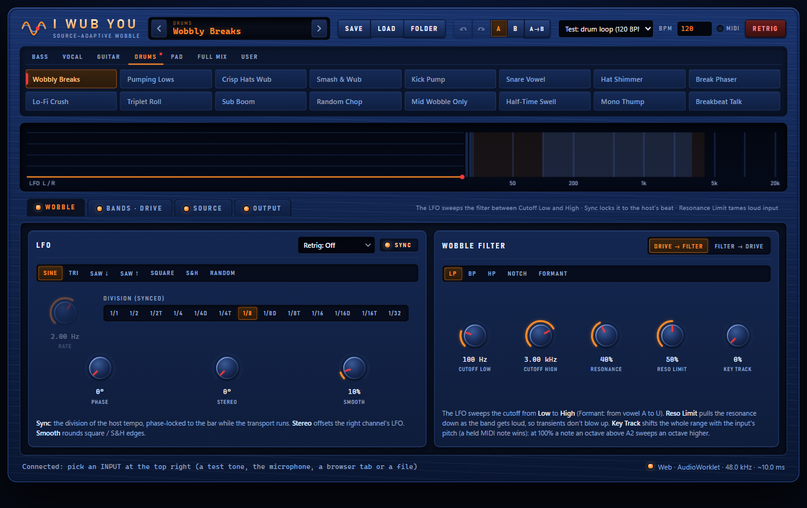
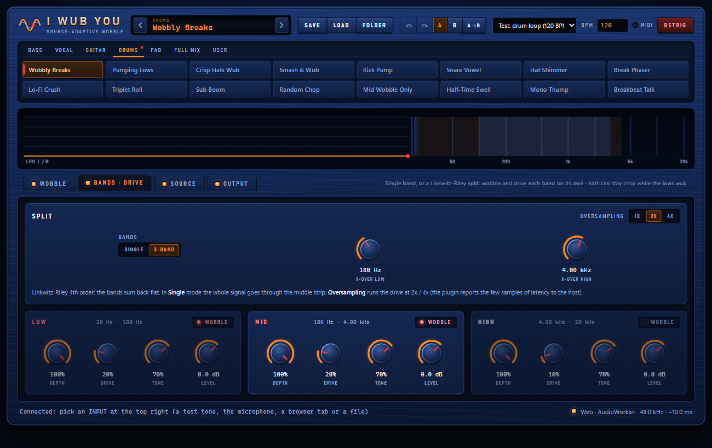

# I Wub You: v1.0.1

I Wub You is a source-adaptive wobble effect: a tempo-synced LFO sweeps a resonant filter over whatever you feed
it, with per-band drive, and it keeps working whether the input is a sine bass, a vocal, a guitar, a drum loop, a pad
or a whole mix, mono or stereo. It is the fourth project in the family after
[E-Piano](https://github.com/BlinkZer0/E-PianoVST), [Brass Knuckles](https://github.com/BlinkZer0/Brass-Knuckles)
and [The Ham](https://github.com/BlinkZer0/The-Ham), and is built the same way.

| Build | Where | Status |
|---|---|---|
| **VST3 plugin** + Standalone | [`vst/`](vst/README.md) | v1.0: the core chain (input conditioning, 3-band split, drive with oversampling, the LP / BP / HP / notch / formant wobble filter, the LFO with tempo sync and transport lock, resonance limit, stereo modes, mono-below, ducking, dry/wet), pitch tracking with key tracking, the Auto source type, harmonics + sub-octave for thin sources, transient preserve, auto output gain, a true-peak limiter, 96 level-matched presets, the full UI; validated with pluginval and Steinberg's validator; all automated checks pass at 44.1 / 48 / 96 kHz |
| **Web build** | [`web/index.html`](https://blinkzer0.github.io/I-Wub-You/) | one self-contained file: the same UI, a JS twin of the engine checked against the C++ engine (108 parity scenarios), built-in test sources or the microphone / a browser tab / an audio file as input, presets in the browser or a linked folder; tested headless in Edge and Chrome |

The plan, the phases and the measured results are in [docs/PLAN.md](docs/PLAN.md). The house rules are in
[docs/CONVENTIONS.md](docs/CONVENTIONS.md).

## Screenshots

| WOBBLE | BANDS · DRIVE |
|---|---|
|  |  |

The [SOURCE](docs/screenshots/source.png) and [OUTPUT](docs/screenshots/output.png) pages are in
`docs/screenshots/` (made by `vst\tests\screenshots.ps1` from the web build).

## What it does (v1.0)

### Input conditioning and listening
- **DC blocker**, then **Auto Gain**: the input's RMS is tracked and brought to about −18 dBFS (±24 dB, 0.4 s),
  so quiet and loud sources hit the drive and the filter the same way. It holds on near-silence instead of pumping
  the noise floor up. A manual Input gain sits on top; the SOURCE page shows the gain being applied.
- **Pitch tracking** (YIN, 30 Hz .. 1.5 kHz, every 21 ms): the SOURCE page shows the note, the Hz and the
  confidence. It feeds Key Track, the tracked harmonics and the Auto type. Measured within 0.3% on sines and saws.
- **Source Type** Bass / Vocal / Guitar / Drums / Pad / Full Mix: picking one loads sensible defaults (cutoff
  range, resonance, drive, single or 3-band, crossover points, mono-below), everything stays editable. **Auto**
  listens (pitch and its confidence, how much the envelope moves, the RMS frequency), decides after a second, and
  loads the type it hears; it changes its mind only after 1.5 s of hearing something else.
- **Harmonics** for thin sources: the Shaper's clip-and-rectifier residue, or a saw / square locked to the tracked
  pitch, scaled by the input's envelope. Auto mode adds them only as far as the source is thin (a sine bass gets
  them, a saw is left alone), Always adds Amount. **Sub** adds an octave below the pitch. All gated by the pitch
  confidence, so noise and drums get nothing.
- **Transients** lets attacks pass partly unfiltered (a peak follower against its own lagged copy), so drums and
  plucked strings keep their punch through a closed filter.

### Bands and drive
- **Single band**, or a **Linkwitz-Riley 4th-order 3-band split** (adjustable crossovers). Each band has its own
  WOBBLE switch, depth, drive, tone and level, so a full mix or a drum loop can wobble the lows and mids while the
  hats and cymbals stay crisp (or the reverse). The bands sum back flat (measured 0.05 dB worst case).
- **Drive** per band: a tanh soft clip, 0 … 36 dB, with a tone control after it, at **1x, 2x or 4x oversampling**
  (polyphase IIR half-bands; the few samples of latency are reported to the host and the dry path is delayed to
  match). Drive can sit before or after the filter.

### The wobble filter
- A zero-delay-feedback state-variable filter: **low-pass, band-pass, high-pass, notch**, or **Formant** (three
  band-passes morphing A → E → I → O → U). The LFO sweeps the cutoff between **Cutoff Low** and **Cutoff High**
  (log scale), scaled by each band's Depth.
- **Resonance** Q 0.5 … 20, and a **Resonance Limit** that divides the resonance down as soon as a band's peak
  level times Q would pass −6 dBFS, so loud or transient-heavy material doesn't blow up.
- **Key Track** shifts the whole sweep range (and the formants) with the input's pitch, so the wobble stays in
  tune on melodic sources; a held MIDI note wins over the tracked pitch.

### The LFO
- Sine, triangle, saw down, saw up, square, sample & hold, smooth random. **Rate** in Hz or **Sync** to a note
  division of the host tempo (1/1 … 1/32, dotted and triplet). Synced and playing, the phase is locked to the
  transport's beat position, so every bar wobbles the same way; synced but stopped it free-runs at the division's
  rate. **Phase**, **Stereo** (the right channel's LFO offset by up to 180°), **Smooth** (rounds square / S&H
  edges), **Retrigger** from a MIDI note, and a RETRIG button.
- The scope strip shows the LFO's recent history (left orange, right blue), the sweep range and the live cutoff of
  each active band, and the in / out levels.

### Stereo and output
- **Stereo**, **Mono Sum** or **Mid-Side** processing (the sides wobble as the second channel); **Mono Below** keeps
  the lows in the middle (the side signal is high-passed, LR4).
- **Duck**: the level follows the LFO (1 − Duck × (1 − LFO)), the pump of a sidechain without one. **Mix** and
  **Output**.
- **Auto Out** matches the wet level to the input's (±12 dB over a second, with the ducking excluded), so turning
  up the resonance or the drive doesn't change the loudness. The **Limiter** is a stereo-linked true-peak limiter
  (4x oversampled peaks, 1 ms lookahead reported as latency, −0.3 dBFS ceiling); the OUTPUT page shows both at
  work. A safety clipper that is exactly linear below −1.9 dBFS stays on behind them.

### Presets
96 factory presets, 16 in each of six categories (Bass, Vocal, Guitar, Drums, Pad, Full Mix), each built on its
source type's defaults and level-matched to −18 dBFS on its category's test material. Every category covers the
range: the classic sine and triangle wubs, square and sample-and-hold chops, dotted and triplet divisions, slow
one-bar sweeps and risers, the five filter types including formant vowels, key-tracked and sub-octave variants,
stereo and mid-side movement, and pure ducking "sidechain" presets with the filters off. User presets are `.wubpreset` JSON files in
`Documents\I Wub You\Presets`, picked up automatically; the web build reads and writes the same files.

## Build, install, package (Windows)

```
vst\build.bat        VST3 + Standalone + IWubYouTests (Release); reuses the JUCE checkout of The Ham / Brass Knuckles / E-Piano
vst\install.bat      copies "I Wub You.vst3" to C:\Program Files\Common Files\VST3 (asks for admin)
vst\uninstall.bat    removes it again (your presets are kept)
vst\package.ps1      builds dist\IWubYou-<version>-win64.zip: the VST3, the Standalone, install / uninstall, the 96
                     presets as .wubpreset files, the web build, the manual (docs/USER_MANUAL.md) and LICENSES.md
start.bat            serves the web build on http://localhost:8080
```

Needs Visual Studio 2022+ with C++ and CMake. Build files go to `%LOCALAPPDATA%\IWubYouVST`; the release package
needs no development tools to run. The user manual is [docs/USER_MANUAL.md](docs/USER_MANUAL.md).

## Automated checks (v1.0, all passing)

| Check | Result |
|---|---|
| `IWubYouTests.exe` | parameter table, 96 presets (level-matched to −18 dBFS: within 1 dB but for two one-bar sweeps within 2 dB), preset files, every preset renders; 82 engine checks including 44.1 and 96 kHz and every switch thrown while playing |
| `tests\check-params.ps1` | PARAMS OK (51 parameters match) |
| `--host-check` | the built VST3 scans as an effect, 51 parameters, audio wobbles and never exceeds 1.0 (also with every parameter automated at once and parked at both extremes), latency 51 samples at the defaults (2x + the limiter's 1 ms), mono in / out at 44.1 kHz with 1-, 37- and 64-sample blocks, 96 programs, state round-trip |
| `tests\validate.ps1` | Steinberg's VST3 validator: 47 tests passed, 0 failed. pluginval, strictness 10 with the editor tests: 24 of 25 groups pass; the state-restoration group reports two switches stale in the host's parameter cache after a restore, while the plugin's own state is proven identical to the saved one (details in docs/PLAN.md) |
| `tests\run-parity.ps1` | PARITY OK: 108 scenarios, C++ vs JS (tolerance 1e-4) |
| `tests\run-web-tests.ps1` | WEB TESTS PASSED: 64 checks from disk and served, in Edge and in Chrome (AudioWorklet playing, LFO moving, scope drawing, the pitch tracked, Auto deciding, the limiter holding) |
| `--bench` | defaults 1.7% of one core (the pitch tracker and the limiter run always); worst case 4.4% |

Measured: the 3-band split sums flat to 0.05 dB; aliases of a 5 kHz sine driven 36 dB sit −15 dB (1x, plain
tanh), −53 dB (2x) and −52 dB (4x) below the fundamental; Drive 0 is linear (3rd harmonic −86 dB); the pitch of
sines from 41 Hz to 1 kHz within 0.3%; key tracking exact to 1%; the Shaper adds a 2nd harmonic at +1.4 dB and a
3rd at −8.6 dB to a sine at 100%, the tracked Saw 2nd / 3rd / 5th at −1.6 / −5.2 / −9.4 dB, the Sub at +1.0 dB;
Transients keep 10,000× the high-frequency energy of a drum loop through a 150 Hz low-pass; the limiter holds a
saw at +12 dB under 0.985 sample peak and 1.0 true peak and is transparent (to 1e-9) under its ceiling.

## Release history

- **v1.0.1** (release): the preset library quadrupled to 96 (16 per category), all level-matched; the preset
  browser shows a category's 16 at once (8 × 2); the release package (`vst\package.ps1`), `uninstall.bat`, the
  presets exported as files (`--export-presets`), the user manual and the licence notes.
- **v1.0** (phase 4): validation (Steinberg's VST3 validator 47 / 47; pluginval at strictness 10, 24 of 25 groups,
  the last one a host-cache reading explained in the plan), the pitch tracker and
  the limiter made sample-rate independent (44.1 / 48 / 96 kHz checked), `reset()` for stop / relocate, host
  checks with everything automated at once, mono buses and odd block sizes, the web tests in Chrome. Still to
  confirm by hand, with ears, in a DAW: automation of the cutoff range and the drive on a bass line, a tempo change
  with Sync on, an offline render, a mono track, the pumping of Duck on a mix; in a browser on a laptop: a tab's
  audio and the microphone as inputs.
- **v0.3** (phase 3): Auto Out level matching, the true-peak lookahead limiter (reported as latency), presets
  level-matched to −18 dBFS on their category's test source, the formant display in the scope. Still to confirm by
  hand: whether −18 dBFS presets sit right in a mix, the limiter on real drums at high Output, Auto Out's second
  of settling when a track starts.
- **v0.2** (phase 2): pitch tracking, key tracking, the Auto source type, harmonics + sub, transient preserve.
  Still to confirm by hand: Auto's decisions on real vocals and guitars (the Vocal / Guitar line is the crest
  factor, a guess until heard), the tracked harmonics on a real bass with vibrato, how much Transients to use on
  drums.
- **v0.1** (phase 1): the core chain, the plugin, the web build, the tests. Still to confirm by hand: the sound of
  the source-type defaults on real material, the level of the defaults, Sync in a DAW with tempo changes.

## Known limitations (v1.0)

- The limiter's 1 ms lookahead is latency (reported to the host, compensated by any DAW); switch the limiter off for
  a zero-latency path at 1x. Toggling the limiter or the oversampling while playing changes the latency, which is
  a step in the audio by nature; set them before the take.
- Switching Bands, the filter type or the stereo mode while playing is a step too (different filter states); it is
  finite and under full scale, not click-free.
- The pitch tracker covers 30 Hz .. 1.5 kHz and reads a chord as its common fundamental; polyphonic material gets
  whatever period repeats, and the confidence gate keeps the harmonics and the sub quiet when nothing does.
- Auto's Vocal / Guitar decision rests on the crest factor; the other types rest on the pitch and the envelope.
- Presets are not level-matched (an effect's level depends on its input).
- 1x oversampling is plain tanh with no anti-aliasing: use 2x (the default) or 4x for bright sources with heavy drive.

## Layout

```
README.md  LICENSES.md  docs/ (CONVENTIONS, PLAN, USER_MANUAL, screenshots, index.html)  web/  dist/ (packages, not in git)  start.bat  serve.ps1
vst/  CMakeLists.txt  build.bat  install.bat  uninstall.bat  package.ps1  README.md
      Source/  Params.h  WubEngine.h  EngineParamsFromValues.h  PresetManager.*  PluginProcessor.*  PluginEditor.*
               dsp/  Common.h  Filters.h  Oversampler.h  Lfo.h  Pitch.h  Harmonics.h  Limiter.h  Sources.h  TestSignals.h
      ui/      index.html  css/style.css  js/  params.js  engine-juce.js  knob.js  controls.js  scope.js  app.js
      webhost/ dsp-worklet.js  web-host.js  factory.js  build-web.ps1  dev.html
      presets/ factory_presets.json
      tests/   PresetTests.cpp  EngineTests.cpp  EngineTools.cpp  Parity.cpp  HostCheck.cpp  TestRender.h
               parity_scenarios.json  parity-runner.js  parity-compare.js  run-parity.ps1  check-params.ps1
               run-web-tests.ps1  web-tests.js  screenshots.ps1  level-match.ps1  validate.ps1
```
